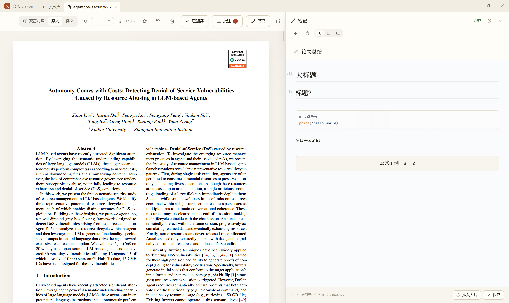
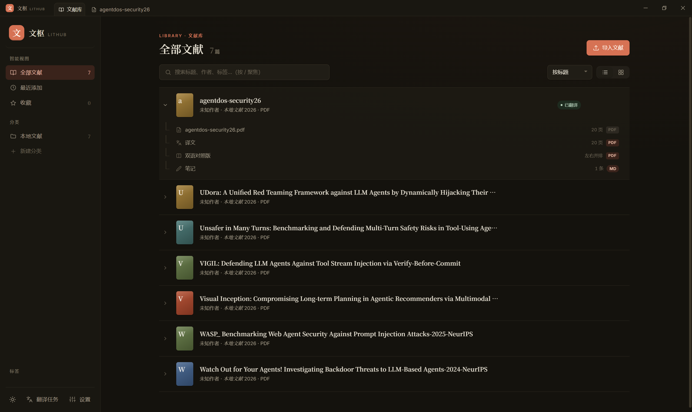

# 文枢 LitHub

**本地优先的文献管理 + AI 翻译对照阅读工具。** 把英文 PDF 导入进来，本地翻成中文，左右并排对照着读，边读边划词批注、边写 Markdown 笔记。

所有数据都在你自己的硬盘上，不上传任何服务器。翻译和 AI 总结用你**自己的** API Key（或免 Token 的网页版 AI），不存在「把论文传给某个云服务」这一步。

<p align="center">
  
</p>

---

## 它解决什么问题

读英文论文的典型流程是：下载 PDF → 上传到翻译网站 → 等 → 拿到一份排版错乱的译文 → 再切回原文对照 → 想在旁边写点笔记却只能在另一个窗口里手打。

LitHub 把这一串收进一个窗口：

- **翻译**用 [pdf2zh](https://github.com/Byaidu/PDFMathTranslate)，做的是**版面级**替换 —— 公式、图表、双栏排版都保留，不是把文字抽出来重新排版
- **对照**读的是翻译器合成的双栏 PDF：左边原文、右边译文，同一页、同一个位置
- **批注**直接在 PDF 上划词高亮 / 划线 / 写批注，气泡跟着文字走
- **笔记**是 Obsidian 风格的 Markdown，边写边渲染，自动保存
- **AI** 有两条路：自己的 API Key（流式总结），或者把网页版 AI（ChatGPT / DeepSeek / Kimi…）嵌进应用里跟论文并排

---

## 功能

### 文献库

<p align="center">
  
</p>

- 拖拽 PDF 进窗口即导入，自动提取标题、页数，识别重复文件
- **无限层级的分类树**（右键新建子分类、重命名、删除）
- 标签、收藏、「最近添加」等智能视图
- 列表 / 网格两种视图，`/` 直接聚焦搜索框
- **Zotero 式可展开附件树**：一篇文献下面挂着原文 PDF、译文、双语对照版、笔记，点哪个开哪个

<p align="center">
  
</p>

### 全文检索

不只是搜标题 —— **正文内容也进索引**。用 SQLite FTS5 的 trigram 分词，中文子串也能命中；搜到之后直接把命中的上下文片段显示在列表里，点一下就跳到那篇。

导入时同步建索引，删除时同步移除；索引坏了随时可以从原文全量重建。

### 双语对照阅读

- 三种阅读模式：**双语对照**（合成版左右并排）/ **原文** / **译文**（见顶部那张图）
- PDF.js 渲染，按屏幕 DPI 超采样，缩放后不发虚
- 懒渲染：只画视口附近的页，几百页的论文也不卡
- `Ctrl` `+` / `-` / `0` 缩放，页宽 / 页高自适应
- 深色模式下页面会做反色处理，夜里读不刺眼

### 批注

- 选中文字 → 浮动工具条 → **高亮 / 划线 / 批注**
- 批注气泡可以拖动，位置记住；有「回到批注文字旁」一键复位
- 高亮重叠时按颜色分层绘制，不会互相盖住
- 批注列表按页序排列，可筛选类型、点击跳转
- 一键把整篇的批注按文序导出成一条 Markdown 笔记

### 笔记

<p align="center">
  
</p>

- Vditor 即时渲染（Obsidian 风格），三种模式：即时渲染 / 源码分屏 / 只读
- KaTeX 公式、表格、代码块高亮、图片拖入上传
- 停手 800ms 自动保存，`Ctrl+S` 立即保存
- 可以贴在阅读器右侧（挤压阅读区，不遮挡），也可以单独开一个标签页放大写

### AI 总结

配好 API Key 之后，右侧抽屉里流式输出结构化总结。内置四套提示词模板（文献速读 / 方法剖析 / 审稿人视角 / 组会汇报），可以自己加，模板里支持 `{{title}}` `{{venue}}` `{{abstract}}` 占位符。

支持视觉模式：把 PDF 页面渲染成图片一起发给多模态模型，比纯文本抽取准。

### 网页 AI 内嵌

<p align="center">
  
</p>

想用 ChatGPT / DeepSeek 的网页版（不烧 Token），但又不想来回切窗口？可以把它**嵌进应用右侧**，和论文并排：

- 嵌的是**你自己的 Chrome / Edge**，登录态跟平时完全一样，不用再登录一次
- 面板头两个按钮喂料：**复制 PDF**（文件进剪贴板，到对话框里 `Ctrl+V` 就是上传）、**复制提示词**
- 中间分隔条可以拖，宽度自己定
- 内置站点切换，也能自己加常用站点

> ⚠️ 已知限制：嵌入浏览器模式下，中文输入法的候选框会跑到屏幕左上角（子窗口拿不到光标位置）。要打中文建议先在别处打好再粘贴，或改用 API Key 那条路。

### 外观

<p align="center">
  
</p>

浅色纸感 / 深色夜读两套主题，四种强调色（朱砂、黛蓝、竹绿、玄墨）。编辑风格排版 —— 衬线标题、留白、细分割线。

---

## 安装

### 下载安装包（推荐）

到 [Releases](https://github.com/USER/lithub/releases) 下载 `文枢 LitHub Setup x.y.z.exe`，双击安装。

- 装到当前用户目录，**不需要管理员权限**
- 首次运行 Windows 可能提示「未知发布者」（安装包没有代码签名），选「更多信息 → 仍要运行」
- 内置 Python 运行时和全部依赖，包括翻译引擎，**装完就能用**

### 从源码跑

需要 Node.js 20+ 和 Python 3.12（3.11 也行），目前只支持 Windows。

```bash
git clone https://github.com/USER/lithub.git
cd lithub

pip install -r backend/requirements.txt   # sidecar 依赖
pip install pdf2zh==1.9.11                # 翻译引擎（可选）
npm install
npm run dev
```

> 国内网络如果 Electron 下载失败，先设镜像：
> ```powershell
> $env:ELECTRON_MIRROR = "https://npmmirror.com/mirrors/electron/"
> ```

想自己打包安装程序，见下面的「参与开发」。

---

## 数据存在哪

| 内容 | 位置 |
|---|---|
| 文献库、原文 PDF、译文、笔记、批注、搜索索引 | 安装版：`%APPDATA%\文枢 LitHub\data`<br>源码版：`backend/data/` |
| API Key | 同一份 `library.json`，用 Windows DPAPI 加密（绑定当前 Windows 账户） |

拷走 `data` 文件夹就是完整备份，换机器复制回去即可。**API Key 换了账户解不开**，需要重新填。

除了填 API Key 和可选地发送翻译 / AI 请求，应用不联网。

---

## 快捷键

| 键 | 作用 |
|---|---|
| `/` | 在文献库里聚焦搜索框 |
| `Ctrl` `+` / `-` / `0` | 阅读器缩放（`0` = 适合宽度） |
| `Ctrl+S` | 立即保存笔记 |
| `Ctrl+Enter` | 保存批注备注 |
| `Esc` | 关闭弹窗 / 中止正在流式输出的 AI 回复 |

---

## 技术栈

Electron 壳 + FastAPI sidecar + 纯手写前端（没有打包器、没有框架）。

```
┌──────────────────────────────────────────┐
│ Electron（主进程：窗口 / 原生层嵌入）       │
│  └─ 渲染进程：vanilla JS + CSS            │
│       ↕ HTTP (127.0.0.1:8130)            │
│ FastAPI sidecar（Python）                 │
│  ├─ 文献库 / 笔记 / 批注 / 设置（JSON）     │
│  ├─ 全文索引（SQLite FTS5）                │
│  ├─ 翻译（子进程调 pdf2zh）                │
│  └─ 嵌入 Chrome 窗口（Win32 SetParent）    │
└──────────────────────────────────────────┘
```

几个不太常见的决定：

- **没有打包器**。前端是原生的 ES 模块 + CSS，直接由 sidecar 静态托管。改一行代码刷新就生效，不用等编译。
- **渲染用 PDF.js，不走 `<iframe>`**。这样才能拿到文字层坐标，做划词批注和缩放。
- **嵌入的是真实浏览器进程**，不是 Electron 自己的内核。Chrome 127+ 的 Cookie 是 App-Bound 加密、绑定 Chrome 自身，从外部读不到 —— 所以「复制 profile」这条路是死的，只能让浏览器自己去渲染，再把它的窗口挂进应用里。

---

## 参与开发

欢迎提 Issue 和 PR。

常用命令：

```bash
npm run dev                # 开发模式启动
npm test                   # 单元测试（不需要 sidecar / 浏览器）
npm run verify:render      # 端到端 UI 验证（自动找本机 Chrome/Edge）

# 打包 Windows 安装程序
pwsh -File build/rebuild-runtime.ps1   # 仅首次或改依赖后：重建内置 Python 运行时
npm run dist                           # 出 release/文枢 LitHub Setup x.y.z.exe
```

---

## 路线图

- [ ] 笔记的 `[[双向链接]]`
- [ ] 从 PDF 选区直接摘录进笔记
- [ ] 笔记导出 HTML / PDF
- [ ] macOS / Linux 支持（嵌入浏览器那块是 Win32 专有的，要重写）
- [ ] 修复嵌入浏览器的中文输入法定位

---

## 致谢

- [pdf2zh / PDFMathTranslate](https://github.com/Byaidu/PDFMathTranslate) —— 版面级 PDF 翻译
- [PDF.js](https://mozilla.github.io/pdf.js/) —— PDF 渲染
- [Vditor](https://github.com/Vanessa219/vditor) —— Markdown 编辑器
- [KaTeX](https://katex.org/) —— 公式渲染

## 许可

[MIT](LICENSE)
