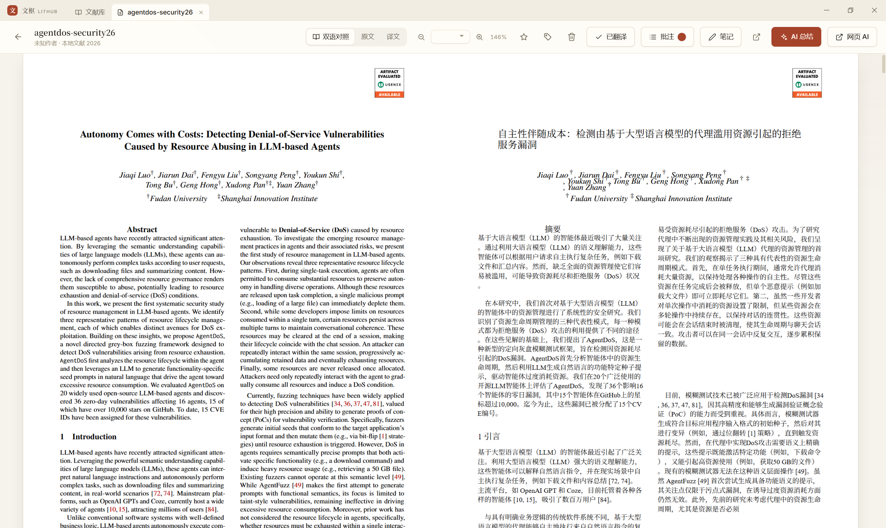
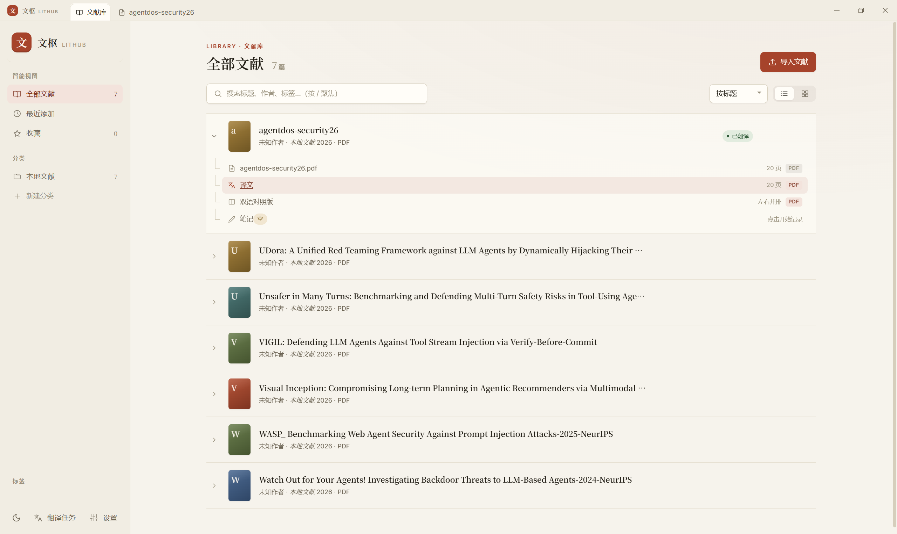
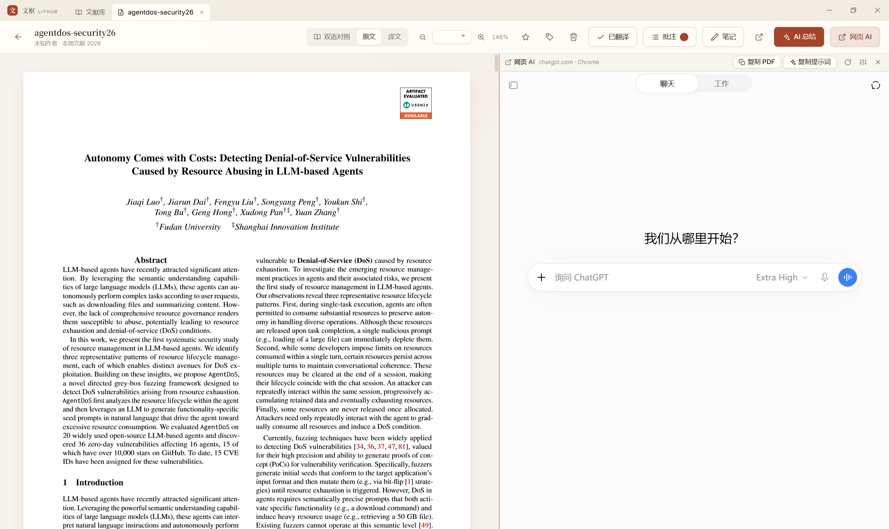

# 文枢 LitHub

**在一个窗口里整理文献、双语阅读、标记重点和记录笔记。**

面向英文论文阅读的 Windows 桌面应用，文献与阅读数据保存在本机。

[下载安装包](https://github.com/InfiniteLin/LitHub/releases) · [快速开始](#快速开始) · [反馈问题](https://github.com/InfiniteLin/LitHub/issues)

Windows x64 · MIT 开源



*原文与译文并排阅读。*

## 主要功能

| 功能 | 可以做什么 |
| --- | --- |
| 文献管理 | 导入 PDF，识别标题与作者，原位改名，通过分类、标签、收藏和全文搜索整理文献 |
| 双语阅读 | 切换原文、译文和双语对照，支持缩放与适合宽度阅读 |
| PDF 标记 | 高亮记录重点、划线标记文字、批注填写说明；不同阅读版本的标记分别保存 |
| Markdown 笔记 | 即时渲染、自动保存、草稿恢复；摘录可跳回论文，笔记可连同图片导出 |
| AI 辅助 | 使用 API 生成总结，或将本机浏览器的网页 AI 嵌在论文旁边讨论 |
| 应用内更新 | 自动检测正式版本，直接下载、校验并重启安装 |



*在文献库中整理论文，展开查看原文、译文与笔记。*

## 快速开始

1. **安装软件**：从 [Releases](https://github.com/InfiniteLin/LitHub/releases) 下载 Windows 安装程序（`.exe`）并安装，无需另装 Python 或 Node.js。
2. **导入论文**：点击「导入文献」或拖入 PDF，按需添加分类和标签。标题与作者在本地识别，标题不准确时可直接改名。
3. **开始阅读**：打开论文即可阅读原文。需要中文时，点击「翻译全文」，完成后切换「双语对照 / 原文 / 译文」。默认 Bing 翻译无需 API Key，但需要联网。
4. **留下记录**：选中文字添加高亮、划线、批注或摘录，在右侧笔记中整理想法。笔记支持自动保存，也可用 `Ctrl+S` 立即保存。

需要 AI 总结时，在「设置 → AI 服务」填写 Base URL、模型和 API Key，测试连接并保存。使用网页 AI 时，请先安装 Chrome / Edge，并在对应浏览器中登录；通过「复制 PDF」「复制提示词」将材料粘贴到对话中。

功能说明以当前源码为准，安装包包含的功能请查看对应版本的发布说明。



*一边阅读论文，一边使用网页 AI。*

## 更新软件

在「设置 → 关于与更新」手动检查，或开启自动检查：启动后后台检测，每 24 小时最多自动检查一次。

发现新版后，点击「下载更新」，可查看进度或取消下载。下载并校验完成后，点击「重启并安装」即可完成更新，无需打开浏览器。软件会先保存笔记；有翻译任务时，请等待完成或取消任务后再安装。文献、PDF 和设置会保留。

旧版本首次升级仍需从 [Releases](https://github.com/InfiniteLin/LitHub/releases) 安装支持此功能的版本。开发版只检查更新。

## 数据与隐私

- **PDF**：新文献库默认存放在程序文件夹的 `pdfs/` 中，可在「设置 → 文件存储」更改；实际位置以设置页为准。
- **文献库、笔记与批注**：安装版默认保存在 `%APPDATA%\文枢 LitHub\data`，源码运行默认保存在 `backend/data/`。
- **联网功能**：翻译与 API 总结会向所选服务发送相关论文内容；网页 AI 使用对应网站的服务。更新检查访问 GitHub，不上传文献或笔记。
- **备份**：确认笔记保存成功后退出软件，同时备份数据目录与 PDF 存储目录。本地草稿不能替代备份；更换 Windows 账户或电脑后，可能需要重新填写 API Key。

## 源码运行

<details>
<summary>开发者：运行与验证</summary>

需要 Node.js 22.13+、Python 3.12 和 Windows。

```powershell
git clone https://github.com/InfiniteLin/LitHub.git
cd LitHub
py -3.12 -m venv .venv
.\.venv\Scripts\Activate.ps1
python -m pip install -r backend/requirements.txt
npm install
npm run dev
```

需要全文翻译时，在同一虚拟环境安装 `pdf2zh==1.9.11`。Electron 会自动启动本地后端；修改主进程或后端后，需要完整退出并重新启动。

开发版与安装版使用独立的运行实例和缓存，可以同时打开；重复启动同一环境会唤回已有窗口。

```powershell
npm test                   # 单元测试
npm run verify:notes-safe  # 独立笔记与编辑器验证
npm run verify:pdf-view    # 合成 PDF 阅读验证
npm run verify:updates     # 更新界面与 Electron 通信验证
```

界面验证需要 Chrome / Edge，以上验证使用独立测试环境，不读取个人文献库。

</details>

## 开源

基于 [PDFMathTranslate](https://github.com/Byaidu/PDFMathTranslate)、[PDF.js](https://mozilla.github.io/pdf.js/)、[Vditor](https://github.com/Vanessa219/vditor) 和 [KaTeX](https://katex.org/) 构建。

采用 [MIT 许可](LICENSE)。欢迎提交 [Issue](https://github.com/InfiniteLin/LitHub/issues) 或 Pull Request。
